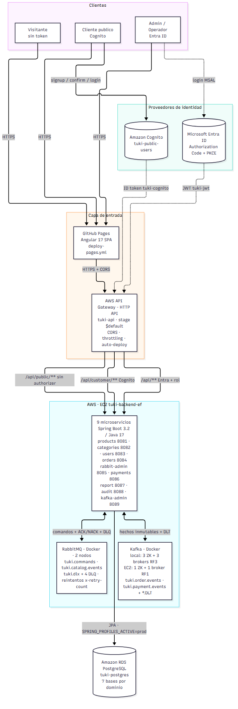
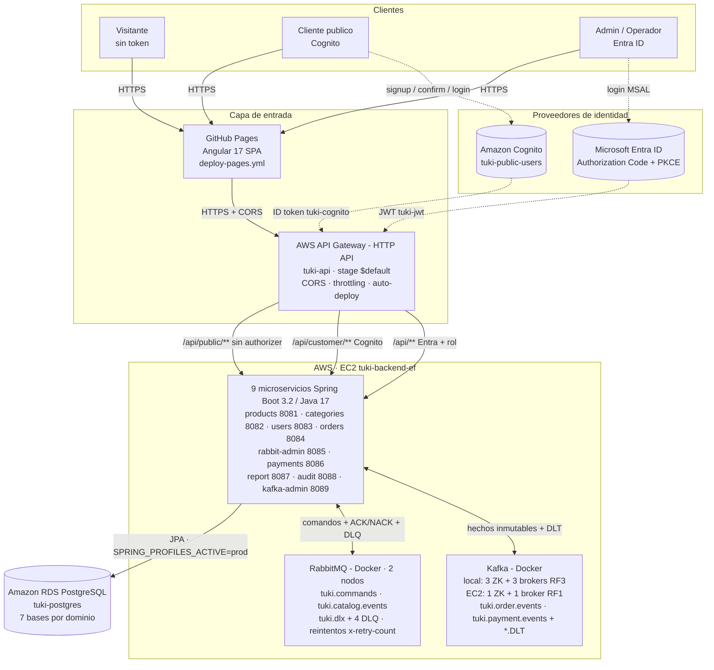
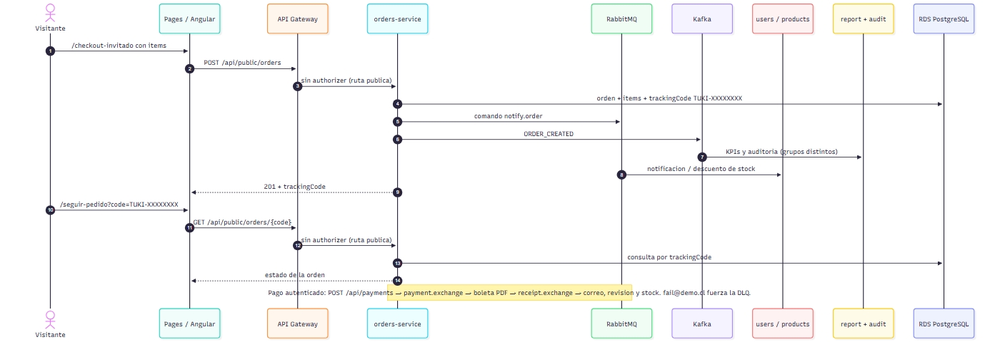
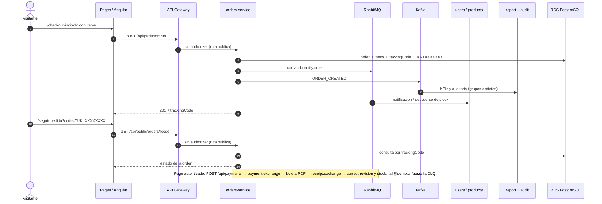

# Arquitectura — Tuki-Tech (Entrega Final EFT)

Diagrama de arquitectura del sistema. La fuente editable en Mermaid está en
[`docs/arquitectura.mmd`](./docs/arquitectura.mmd); se puede exportar a PNG/SVG con:

```bash
npx @mermaid-js/mermaid-cli -i docs/arquitectura.mmd -o docs/arquitectura.png --size 1800
```

Las imágenes ya generadas están en [`docs/arquitectura.png`](./docs/arquitectura.png)
y [`docs/flujo-compra.png`](./docs/flujo-compra.png), listas para insertar en
diapositivas.

## 1. Vista general





## 2. Flujo de compra pública y pago





## 3. Servicios y responsabilidad

| Servicio | Puerto | Responsabilidad | Persistencia |
|---|---:|---|---|
| products | 8081 | Catálogo público y administración; descuento de stock | `tuki_products` |
| categories | 8082 | Categorías públicas y administración | `tuki_categories` |
| users | 8083 | Perfiles, roles y consumidores de notificaciones | `tuki_users` |
| orders | 8084 | Órdenes autenticadas, guest y tracking | `tuki_orders` |
| rabbitmq-admin | 8085 | Colas, exchanges, bindings y demo de DLQ | — |
| payments | 8086 | Pago simulado y boleta PDF (OpenPDF) | `tuki_payments` |
| report | 8087 | Consumidor Kafka de KPIs | `tuki_reporting` |
| audit | 8088 | Consumidor Kafka de trazabilidad | `tuki_audit` |
| kafka-admin | 8089 | Tópicos, configuraciones, grupos y offsets | — |

## 4. Decisiones de diseño

- **Dos brokers de mensajería con roles distintos.** RabbitMQ transporta
  *comandos* que deben ejecutarse una vez y confirmarse (notificación, stock,
  revisión), con ACK manual, 3 reintentos (`x-retry-count`) y DLQ por cola.
  Kafka transporta *hechos ya ocurridos* (`ORDER_CREATED`, `PAYMENT_APPROVED`)
  que varios consumidores leen a su ritmo, con DLT y 3 reintentos.
- **Dos proveedores de identidad.** Entra ID para admin/operador (MSAL + PKCE)
  y Cognito para el usuario público. El API Gateway declara un authorizer por
  familia de rutas; el backend repite la validación de issuer/audience y mapea
  los tokens Cognito siempre a `ROLE_customer`, nunca a `ROLE_admin`.
- **Doble validación JWT.** El gateway valida firma, issuer y audience antes de
  enrutar; cada microservicio vuelve a validar con `NimbusJwtDecoder` y aplica
  `@PreAuthorize` por rol.
- **Una base por dominio.** H2 con `create-drop` en local; PostgreSQL en el
  perfil `prod` (`ddl-auto: update`) con una base por servicio JPA en RDS.
- **SPA estática.** GitHub Pages solo sirve archivos; la URL del gateway se
  genera en CI desde Variables del repositorio, por lo que no hay secretos en
  el bundle.

## 5. Topología según el entorno

| Componente | Local / `docker-compose.full.yml` | AWS |
|---|---|---|
| RabbitMQ | 2 nodos, UI `:15672` | 2 nodos en EC2, UI pública |
| Kafka | 3 Zookeeper + 3 brokers, RF 3, ISR 2, Kafka UI `:8080` | 1 ZK + 1 broker en EC2, RF 1, ISR 1 (MSK denegado por IAM) |
| PostgreSQL | Contenedor `postgres:16` | RDS `tuki-postgres`, 7 bases |
| Backend | 9 contenedores Spring Boot | systemd en `tuki-backend-ef` |
| Frontend | `http://localhost:4200` | GitHub Pages |

## 6. Guías relacionadas

- [README.md](./README.md) — descripción general, instalación y endpoints.
- [ESTUDIO_EFT.md](./ESTUDIO_EFT.md) — mapa mental y mapa de rúbrica.
- [GUIA_DEFENSA_EFT.md](./GUIA_DEFENSA_EFT.md) — guion de defensa de 10 minutos.
- [RABBITMQ_SETUP.md](./RABBITMQ_SETUP.md) y [KAFKA_SETUP.md](./KAFKA_SETUP.md).
- [API_GATEWAY_DEPLOYMENT.md](./API_GATEWAY_DEPLOYMENT.md) y [EC2_DEPLOYMENT.md](./EC2_DEPLOYMENT.md).
